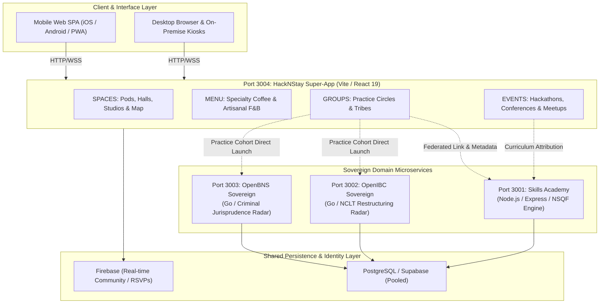
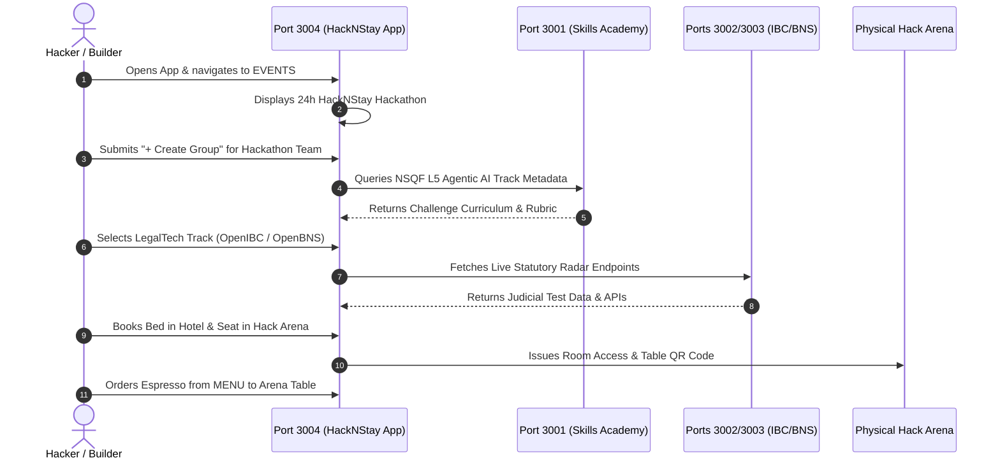

# System Architecture & Network Topology

This document details the architectural blueprint of the **Agentic Professionals Federated Network** and how it integrates with the physical **HackNStay** venue.

---

## 1. Architectural Philosophy

The ecosystem is built on two core principles:
1. **Sovereign Domain Separation:** High-stakes professional domains (corporate law, criminal jurisprudence, vocational qualification) must not be mashed into a fragile monolithic backend. Each operates as an independent microservice with its own runtime, domain logic, and API radar.
2. **Phygital (Physical + Digital) Convergence:** Digital software is anchored to physical real estate. Physical spaces (conference halls, hotel rooms, podcast studios) consume and display digital services, while digital apps order physical amenities (specialty coffee, room stays, hall reservations).

---

## 2. Microservice Profiles

### 🎓 Port 3001: Sovereign Skills Academy
* **Directory:** `skills.agenticprofessionals/`
* **Runtime:** Node.js (v20+), Express.js
* **Primary Responsibilities:**
  * Curricular framework aligned with India's **National Skills Qualifications Framework (NSQF)**.
  * Level 4: MSME Digital Commerce & Supply Chain.
  * Level 5: Agentic AI Engineering & Multi-Agent Systems.
  * Level 6: Cloud Native Microservices & Sovereign Infrastructure.
  * Student progress tracking, competency evaluations, and agent certification badges.
* **Internal Port:** `3001`

### ⚖️ Port 3002: OpenIBC Sovereign Practice Hub
* **Directory:** `ibc.agenticprofessionals/`
* **Runtime:** Go (Golang 1.21+)
* **Primary Responsibilities:**
  * Autonomous tracking of the **Insolvency and Bankruptcy Code (IBC, 2016)**.
  * NCLT (National Company Law Tribunal) & NCLAT judicial radar.
  * Corporate Insolvency Resolution Process (CIRP) timeline calculation.
  * Committee of Creditors (CoC) voting protocols and liquidation waterfall valuation.
* **Internal Port:** `3002`

### 🛡️ Port 3003: OpenBNS Sovereign Justice Hub
* **Directory:** `bns.agenticprofessionals/`
* **Runtime:** Go (Golang 1.21+)
* **Primary Responsibilities:**
  * Statutory mapping of the **Bharatiya Nyaya Sanhita (BNS)**, replacing legacy IPC provisions.
  * Cyber forensics radar: Section 61 electronic evidence indexing and digital FIR validation.
  * Police station remand calculator, bail admissibility heuristics, and criminal trial tracking.
* **Internal Port:** `3003`

### 📱 Port 3004: HackNStay Phygital Super-App
* **Directory:** `aicafe.agenticprofessionals/`
* **Runtime:** React 19, TypeScript, Vite v6, Tailwind CSS
* **Primary Responsibilities:**
  * **SPACES:** Real-time discovery and reservation of physical units (Private Pods, Briefing Rooms, Podcast Studios, The Hack Arena, Skyline Terraces).
  * **MENU:** Full point-of-sale ordering for craft coffee (pour-overs, cold brew) and meals (burritos, rice bowls, sandwiches) delivered directly to seats or rooms.
  * **GROUPS:** Community tribes categorized by NSQF skills and legal cohorts.
  * **EVENTS:** Ticketing, scheduling, and live attendee roster for 24h–48h hackathons, conferences, and founder celebrations.
* **Internal Port:** `3004` (Network accessible: `http://0.0.0.0:3004`)

---

## 3. Inter-Service Communication & Data Flow

---

## 4. Port Allocation & Health Check Standards

Every service implements standard HTTP health endpoints:

| Port | Service Identifier | Health Endpoint | Protocol | Expected Status |
| :--- | :--- | :--- | :--- | :--- |
| `3001` | `skills-agenticprofessionals` | `GET http://localhost:3001/` | HTTP/1.1 | `200 OK` (HTML/JSON) |
| `3002` | `ibc-agenticprofessionals` | `GET http://localhost:3002/` | HTTP/1.1 | `200 OK` (HTML/API) |
| `3003` | `bns-agenticprofessionals` | `GET http://localhost:3003/` | HTTP/1.1 | `200 OK` (HTML/API) |
| `3004` | `aicafe-agenticprofessionals` | `GET http://localhost:3004/` | HTTP/1.1 | `200 OK` (Vite SPA) |

---

## 5. Production Cloud Deployment (Render Blueprint)

The entire federated network is declared in the root [render.yaml](file:///Users/atulgrover/Desktop/AgenticProfessionals/render.yaml):

1. **Service 1:** `skills-agenticprofessionals` (Node web service with database pool).
2. **Service 2:** `ibc-agenticprofessionals` (Go native binary web service).
3. **Service 3:** `bns-agenticprofessionals` (Go native binary web service).
4. **Service 4:** `aicafe-agenticprofessionals` (Static SPA publishing `dist/` with single-page URL rewrites).

---

## 6. Security & Environment Configuration

* **Environment Isolation:** Every microservice contains its own dedicated `.env` file for API keys, secrets, and database credentials.
* **Host Verification:** In Vite v6, `server.allowedHosts: true` is configured to enable multi-device testing over local Wi-Fi without blocking mobile clients.
* **Database Pooling:** Database connections use pooled connection strings to prevent serverless connection exhaustion.
