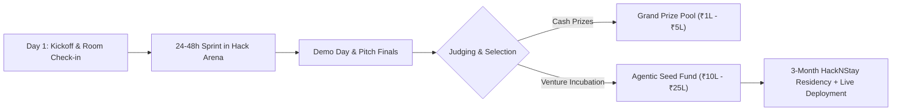

# HackNStay: Offline Hackathon & Incubation Playbook

This document details the official playbook for running **24-hour and 48-hour offline hackathons** at **HackNStay**, and how participating projects transition from hackathon prototypes into **incubated, seed-funded, and deployed** microservices.

---

## 1. The Core Philosophy: "Build, Stay, Pitch, Get Funded"

Most hackathons end on Sunday afternoon with a plastic trophy and abandoned GitHub repositories. 

**HackNStay flips the model:**
* **We provide the physical sanctuary:** Hotel rooms to sleep in, 24h conference halls to build in, and artisanal cafe food to sustain energy.
* **We provide the sovereign stack:** Real-world legal radars, national curriculum frameworks, and phygital commerce APIs.
* **We provide the capital & deployment:** Winning teams receive seed funding, extended residency at the hotel, and direct deployment into our live federated network.



---

## 2. The 4 Official Hackathon Challenge Tracks

Every hackathon hosted at HackNStay challenges builders to create autonomous agents within four core domains:

### 🏆 Track 1: Agentic Swarms & Autonomous Workflows (Port 3001)
* **Core Technology:** LangGraph, CrewAI, AutoGen, Ollama edge inference, Google Gemini Interactions API.
* **Problem Statements:**
  * Build an autonomous agent that ingests messy corporate PDFs, generates NSQF-compliant training modules, and tests student comprehension.
  * Build a multi-agent self-healing code review swarm that autonomously clones GitHub repos, runs unit tests, fixes security vulnerabilities, and opens pull requests.

### ⚖️ Track 2: Corporate Restructuring & Insolvency Radar (Port 3002)
* **Core Technology:** OpenIBC Sovereign APIs, Go microservices, NCLT judicial scrapers, financial ledger vectorization.
* **Problem Statements:**
  * Build an NCLT Radar Agent that monitors daily causelists, flags Section 7/9 insolvency admissions against corporate debtors, and notifies institutional lenders in real time.
  * Build an automated Resolution Plan Valuation Agent that audits liquidation waterfall distributions under Section 53 of the IBC.

### 🛡️ Track 3: Bharatiya Nyaya Sanhita & Cyber Forensics (Port 3003)
* **Core Technology:** OpenBNS Sovereign APIs, digital FIR parsing, cryptographic hash auditing, Section 61 evidence chain verification.
* **Problem Statements:**
  * Build a police station custody & remand assistant that computes statutory deadlines under the BNS/BNSS to prevent procedural bail defaults.
  * Build an autonomous cyber crime evidence ledger that ingests phishing reports, extracts server telemetry, and prepares court-admissible forensic certificates.

### ☕ Track 4: Phygital Hospitality & ONDC Commerce (Port 3004)
* **Core Technology:** React 19, Leaflet, Razorpay webhooks, ONDC Beckn protocol, local IoT hardware triggers.
* **Problem Statements:**
  * Build an autonomous voice-ordering agent for cafe tables that transcribes multilingual customer requests and dispatches orders to the kitchen display.
  * Build a smart room energy optimization agent that coordinates hotel room temperature and lighting based on calendar hackathon schedules.

---

## 3. Standard 48-Hour Hackathon Schedule

```
FRIDAY
│ 04:00 PM - 06:00 PM │ Hacker Arrival, Hotel Room Check-in & Badge Issuance
│ 06:30 PM - 07:30 PM │ Keynote Address & Challenge Track Announcements (Hack Arena)
│ 07:30 PM - 08:30 PM │ Sunset Welcome Mixer & Barbecue (Skyline Terrace)
│ 09:00 PM            │ HACKING COMMENCES (24/7 Arena Doors Locked to Public)
│ 11:30 PM            │ Midnight Espresso & Cold Brew Rounds

SATURDAY
│ 08:00 AM - 09:30 AM │ High-Protein Breakfast at AI Cafe
│ 11:00 AM - 01:00 PM │ Mentor Checkpoints & Architecture Validation
│ 01:30 PM - 02:30 PM │ Lunch Burritos & Power Bowls
│ 04:00 PM - 05:00 PM │ Private Pod Pitch Rehearsals with EIRs (Entrepreneurs in Residence)
│ 08:00 PM - 09:00 PM │ Dinner & Fireside Founder Chat
│ 12:00 AM            │ Midnight Pizza Sprint & Energy Refresh

SUNDAY
│ 08:00 AM - 09:00 AM │ Breakfast & Code Freeze Warning
│ 10:00 AM            │ FINAL CODE FREEZE & GitHub Submission
│ 11:00 AM - 01:30 PM │ Demo Day Pitch Finals (5 mins pitch + 3 mins Q&A per team)
│ 02:00 PM - 03:00 PM │ Award Ceremony, Incubation Offers & Lunch Celebration
│ 04:00 PM            │ Checkout or Residency Induction
```

---

## 4. Judging Rubric (100 Points Total)

1. **Autonomous Execution & Agentic Depth (30 pts):**
   * Does the project make intelligent tool calls, handle edge cases, and self-correct, or is it just a basic prompt-in/prompt-out wrapper?
2. **Integration with Sovereign Ports (25 pts):**
   * Does the solution connect cleanly with Port 3001, 3002, 3003, or 3004 APIs?
3. **Real-World Practical Utility (20 pts):**
   * Does it solve a genuine pain point for corporate insolvency, criminal justice, education, or hospitality?
4. **Code Quality & Architecture (15 pts):**
   * Modular repository structure, clean git history, error handling, and security posture.
5. **Pitch & Live Demonstration (10 pts):**
   * Working live demonstration in The Hack Arena with zero slide-only mockups.

---

## 5. Incubation & Seed Fund Terms

Selected top-tier projects are invited to join the **Agentic Professionals Incubator**:

| Offering | Details |
| :--- | :--- |
| **Cash Grants** | ₹1,00,000 to ₹5,00,000 immediate non-dilutive prize money. |
| **Pre-Seed Investment** | ₹10 Lakhs to ₹25 Lakhs convertible note for incorporating teams. |
| **HackNStay Residency** | 3 months of complimentary private hotel room accommodation and 24/7 Hack Arena desk space for the founding team. |
| **Compute Credits** | Dedicated high-end GPU cluster access and LLM API credits. |
| **Production Deployment** | Direct integration as an officially listed microservice in the Agentic Professionals Network (e.g. `*.agenticprofessionals.com`). |
