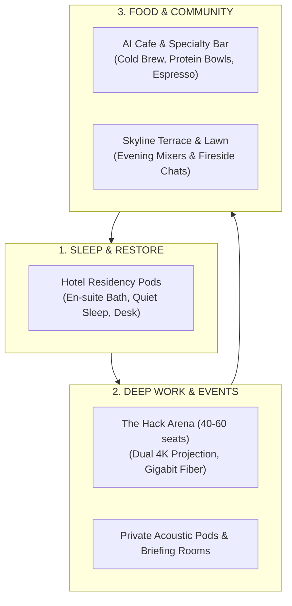

# HackNStay: Physical Venue & Hospitality Blueprint

This document specifies the architectural, operational, and physical layout for transforming the **RIO Hotel & AI Cafe** property into **HackNStay** — India's premier AI builder residency, hackathon venue, and phygital tech hotel.

---

## 1. Property Vision & The "Phygital" Flywheel

Traditional hotels sell sterile room nights; co-working spaces sell desks by day but lock up at night. **HackNStay** combines both into a self-sustaining ecosystem:

---

## 2. Space Inventory & Technical Specifications

### A. The Hack Arena (Conference & Demo Hall)
* **Capacity:** 40–60 Active Hackers (Modular cluster tables)
* **Audio/Visual:**
  * Dual high-lumen 4K laser projectors with mirrored wireless screen casting (AirPlay/Miracast).
  * Shure wireless handheld and lapel microphone array.
  * Ceiling acoustic baffles to absorb keyboard clatter and group debates.
* **Power & Network:**
  * Dedicated 1 Gbps redundant fiber internet connections (dual ISP failover).
  * Dual AC outlets + USB-C PD (65W) built directly into every workstation table.
* **Usage:** 24h Hackathons, keynote presentations, demo day pitch finals, cohort sprints.

### B. Private Agent Pods (1–2 Persons)
* **Quantity:** 4 Pods
* **Specs:**
  * Acoustic glass booth (40 dB sound reduction).
  * Dual 27-inch 4K color-calibrated monitors with single USB-C cable docking.
  * Herman Miller / Steelcase style ergonomic mesh chair.
* **Usage:** Intense solo coding, prompt engineering, private investor/client calls.

### C. Legal & Executive Briefing Rooms (6–8 Persons)
* **Specs:**
  * Smart digital touchscreen whiteboard with real-time cloud sync.
  * Encrypted 4K conference camera and beamforming microphone.
  * Acoustic privacy blinds.
* **Usage:** IBC tribunal case simulations, NCLT defense rehearsals, investor boardroom meetings.

### D. Broadcast & Podcast Studio (3–4 Persons)
* **Specs:**
  * 4x Shure SM7B dynamic studio microphones on Rode boom arms.
  * Rodecaster Pro audio mixer.
  * 3x Sony/Blackmagic 4K cameras with studio ring and fill lighting.
  * Full acoustic foam paneling.
* **Usage:** Technical podcasts, recorded founder keynotes, course creation for Port 3001.

### E. Skyline Terrace & Event Lawn (80–120 Persons)
* **Specs:**
  * Open-air rooftop with panoramic city views.
  * Ambient warm fairy lighting and live acoustic sound system.
  * Dedicated mocktail and barbecue counter.
* **Usage:** Hackathon kickoffs, sunset networking mixers, celebration dinners, founder birthdays.

### F. Residency Pods (Hotel Rooms)
* **Inventory:** Converted hotel rooms across floors.
* **Specs:**
  * High-density orthopedic mattress for restorative sleep after late-night sprints.
  * Soundproof double-glazed windows.
  * High-speed in-room Wi-Fi (separate VLAN from public cafe).
  * Ergonomic secondary work desk.
  * Keyless NFC mobile door access via the HackNStay App.

---

## 3. The AI Cafe Food & Beverage Operations

The in-house cafe serves as both a community living room and an energetic fuel station:

### Menu Architecture
1. **Focus & Brain Fuel (Coffee & Teas):**
   * Single-origin espresso, Aeropress, V60 pour-overs.
   * Nitro cold brew on tap.
   * Herbal matchas and iced teas.
2. **Clean Nutrition (Sustained Energy, Zero Crash):**
   * High-protein rice and quinoa bowls (BBQ Chicken, Mexican Paneer, Tofu).
   * Artisanal sourdough sandwiches and panini.
   * Tortilla burritos designed for one-handed eating while coding.
3. **Point of Sale & In-Seat Delivery:**
   * Guests order directly from the mobile app (Port 3004 `MENU` tab).
   * Orders are delivered to specific table QR codes in the Hack Arena, private pods, or direct to hotel rooms.

---

## 4. Operational & Pricing Models

### Tier 1: Day Hacker Pass (₹499 / day)
* Full access to The Hack Arena from 8:00 AM to 11:00 PM.
* 1 Gbps high-speed Wi-Fi.
* 1 Complimentary Cold Brew or artisanal espresso.
* Access to open community events.

### Tier 2: The 48-Hour Hackathon Ticket (₹1,499 – ₹2,999)
* 48 hours of continuous 24/7 access to The Hack Arena.
* Unlimited filter coffee.
* Hackathon meals (breakfast, lunch, dinner, midnight pizza).
* Shared sleeping pod access or nap zone.

### Tier 3: The "Hack-and-Stay" Residency (Weekly / Monthly)
* **Weekly Sprint Pass (₹14,999 / week):**
  * 7 nights private hotel room stay.
  * 24/7 reserved desk in The Hack Arena.
  * Daily breakfast + cafe meal allowance.
  * 5 hours complimentary Private Pod booking.
* **Monthly Fellowship Cohort (₹49,999 / month):**
  * 30 nights private hotel room stay.
  * Unlimited workspace and pod booking.
  * Direct mentorship from Port 3001 instructors and Port 3002/3003 sovereign builders.
  * Pitch access to the Agentic Professionals Seed Fund.

---

## 5. Network & Security Architecture

* **Multi-SSID Isolation:**
  * `HackNStay-Arena` (VLAN 10): High-priority, unthrottled 1 Gbps fiber for builders.
  * `HackNStay-Rooms` (VLAN 20): Secure hotel guest Wi-Fi.
  * `HackNStay-Cafe` (VLAN 30): Public guest Wi-Fi with client isolation.
  * `HackNStay-IoT` (VLAN 40): POS terminals, digital locks, smart whiteboards.
* **Access Control:**
  * Smart digital locks integrated with the Port 3004 RSVP and booking engine.
  * RFID/NFC cards issued at front desk or unlocked via mobile Bluetooth.
