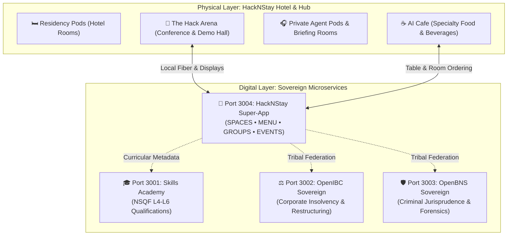

# Agentic Professionals & HackNStay — Master Documentation

Welcome to the foundational documentation for the **Agentic Professionals Federated Network** and the **HackNStay Phygital Residency & AI Cafe**.

This ecosystem bridges physical hospitality (hotel accommodations, conference halls, and specialty cafes) with a sovereign digital multi-agent network (skills certification, corporate restructuring law, criminal jurisprudence, and autonomous commerce).

---

## 📚 Document Index

| Document | Purpose | Key Audience |
| :--- | :--- | :--- |
| [**ARCHITECTURE.md**](file:///Users/atulgrover/Desktop/AgenticProfessionals/docs/ARCHITECTURE.md) | Technical topology, port allocations (3001–3004), inter-service protocols, data contracts, and Render deployment blueprint. | Architects, Backend Developers, DevOps |
| [**HACKNSTAY_BLUEPRINT.md**](file:///Users/atulgrover/Desktop/AgenticProfessionals/docs/HACKNSTAY_BLUEPRINT.md) | Physical real estate blueprint: Hotel room conversion, 24h Hack Arena, Private Pods, Briefing Rooms, and AI Cafe operations. | Venue Managers, Operations, Event Hosts |
| [**HACKATHONS.md**](file:///Users/atulgrover/Desktop/AgenticProfessionals/docs/HACKATHONS.md) | The "Hack-and-Stay" offline hackathon playbook: 4 problem tracks, judging rubrics, incubation fund, and venture acceleration. | Builders, Hackers, Mentors, Judges |
| [**API_RADAR.md**](file:///Users/atulgrover/Desktop/AgenticProfessionals/docs/API_RADAR.md) | Developer guide: Endpoints, sample payloads, health checks, and SDKs for building sovereign subagents. | Agent Developers, Integrators |

---

## 🌐 Quick Network Topology Summary



---

## 🚀 Running the Local Ecosystem

All four microservices can be orchestrated using the workspace root scripts:

```bash
# Start all 4 services in the background
./start.sh

# Verify live health status of all ports (3001, 3002, 3003, 3004)
./status.sh

# Gracefully terminate all background services
./stop.sh
```
