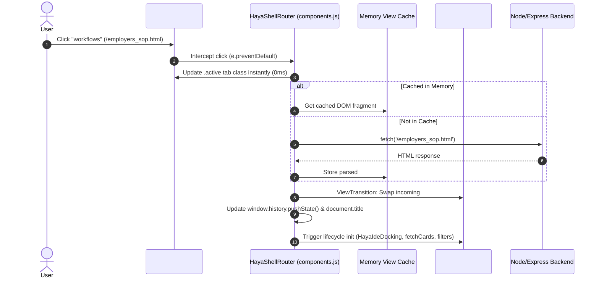

# Design Spec: Persistent App Shell & Decoupled Viewport Architecture

- **Date**: 2026-11-15
- **Author**: Antigravity & User Team
- **Status**: Draft for User Review
- **Target Release**: Agentic Hayagriva Unified Platform

---

## 1. Problem & Context

1. **Header Inconsistency**:
   - `employees_nsqf.html` (Playbooks) looks visually different from `employers_sop.html` (Workflows) and `entrepreneurs_msme.html` (Ventures).
   - In `employees_nsqf.html`, lines 57–112 contain an obsolete local `<style>` block that overrides the universal header:
     - `.brand-logo` is set to `font-size: 20px; letter-spacing: 1.5px;` and omits `display: inline-flex; align-items: center; gap: 10px;`. This misaligns the Hayagriva unicorn icon vertically and stretches the brand title.
     - `.nav-link` is set to `font-weight: 500;` instead of `font-weight: 600;`, making the navigation tabs appear thinner.
   - In contrast, `employers_sop.html` and `entrepreneurs_msme.html` have no local overrides and inherit the clean styling directly from `css/responsive.css`.

2. **Page Jumping on Navigation**:
   - The three core economic pillars are structured as separate Multi-Page Application (MPA) files (`employees_nsqf.html`, `employers_sop.html`, `entrepreneurs_msme.html`).
   - Clicking between `playbooks`, `workflows`, and `ventures` triggers a hard browser navigation (`HTTP GET`).
   - The browser destroys the DOM tree, resets scroll position to `(0, 0)`, and re-renders the document from scratch.
   - Even with pre-rendered headers, this hard page cycle produces a visible visual jump, layout flicker, and repaint jitter.
   - Furthermore, the header currently participates in document flow (`position: sticky`), making it coupled to the page's vertical scroll.

---

## 2. Core Objectives & Success Criteria

1. **100% Visual Header Parity**:
   - Remove all stale local header overrides in `employees_nsqf.html`.
   - Ensure the Hayagriva unicorn logo, brand text `agentic hayagriva`, and lowercased tabs (`playbooks`, `workflows`, `ventures`) are rendered identically down to the exact pixel and font weight across all pages.

2. **Decoupled 3-Tier Layout Shell**:
   - **Tier 1 (Header Shell)**: Fixed at viewport top (`height: 64px; top: 0; left: 0; right: 0; z-index: 10000;`). Outside the content scroll flow.
   - **Tier 2 (Workspace Shell `#app-workspace`)**: Occupies `top: 64px; bottom: 0; left: 0; right: 0;` (or flex-1 inside locked 100vh body). Its inner panels (`.panel-left`, `.panel-center`, `.panel-right`) own their independent scrolling.
   - **Tier 3 (Footer Shell `#site-footer`)**: Persistent or docked independently.

3. **Persistent PJAX/Turbo Workspace Router (`HayaShellRouter`)**:
   - Intercept navigation clicks on pillar links (`employees_nsqf.html`, `employers_sop.html`, `entrepreneurs_msme.html`).
   - Keep `#site-header` permanently mounted in the DOM. Do **not** destroy or recreate header elements.
   - Swap **only** `#app-workspace` content using `fetch()` and an in-memory cache.
   - Support smooth `document.startViewTransition()` cross-fade when available.
   - Update URL with `history.pushState()` and support browser Back/Forward (`popstate`).
   - Re-initialize page scripts cleanly via lifecycle hooks (`onMount`, `onDestroy`).

---

## 3. Architecture & System Flow

```
┌────────────────────────────────────────────────────────────────────────┐
│                        PERSISTENT BROWSER WINDOW                       │
│                                                                        │
│  ┌──────────────────────────────────────────────────────────────────┐  │
│  │ #site-header (Fixed 64px, z-index: 10000)                        │  │
│  │ [🦄 agentic hayagriva]      [playbooks] [workflows] [ventures]    │  │
│  └──────────────────────────────────────────────────────────────────┘  │
│                                                                        │
│  ┌──────────────────────────────────────────────────────────────────┐  │
│  │ #app-workspace (top: 64px, bottom: 0, overflow: hidden)          │  │
│  │                                                                  │  │
│  │  ┌────────────────────────────────────────────────────────────┐  │  │
│  │  │ .pillar-hero (Hero title & metrics row)                    │  │  │
│  │  └────────────────────────────────────────────────────────────┘  │  │
│  │  ┌────────────────────────────────────────────────────────────┐  │  │
│  │  │ .ide-container (3-Panel Docking Workbench)                 │  │  │
│  │  │  ┌───────────────┬─────────────────────────┬────────────┐  │  │  │
│  │  │  │ .panel-left   │ .panel-center           │.panel-right│  │  │  │
│  │  │  │ (Filters/SOP) │ (Cards & Content Grid)  │(Details/AI)│  │  │  │
│  │  │  └───────────────┴─────────────────────────┴────────────┘  │  │  │
│  │  └────────────────────────────────────────────────────────────┘  │  │
│  └──────────────────────────────────────────────────────────────────┘  │
└────────────────────────────────────────────────────────────────────────┘
```

### Navigation Lifecycle Flow (PJAX Workspace Swap)



---

## 4. Detailed Component Design

### 4.1. Header CSS Unification & Viewport Framing (`css/responsive.css`)
- Remove duplicate `.header-nav`, `.nav-container`, `.brand-logo`, `.nav-links`, `.nav-link` from `employees_nsqf.html`.
- Consolidate in `css/responsive.css`:
  ```css
  html, body {
    height: 100%;
    margin: 0;
    padding: 0;
    overflow: hidden; /* Lock window scroll; workspace manages internal scrolling */
  }

  #site-header {
    position: fixed;
    top: 0;
    left: 0;
    right: 0;
    height: 64px;
    z-index: 10000;
    background: #FFFFFF;
  }

  #app-workspace {
    position: fixed;
    top: 64px;
    bottom: 0;
    left: 0;
    right: 0;
    overflow-y: auto;
    overflow-x: hidden;
    display: flex;
    flex-direction: column;
  }
  ```

### 4.2. Workspace Wrapper Across Pillar HTML Files
Wrap the main hero and IDE container on all 3 pages inside a standardized `#app-workspace`:
- `employees_nsqf.html`:
  ```html
  <main id="app-workspace" data-view="playbooks">
    <section class="pillar-hero">...</section>
    <div class="ide-container" id="ideContainer">...</div>
    <div id="site-footer"></div>
  </main>
  ```
- `employers_sop.html`:
  ```html
  <main id="app-workspace" data-view="workflows">
    <section class="pillar-hero">...</section>
    <div class="ide-container" id="ideContainer">...</div>
    <div id="site-footer"></div>
  </main>
  ```
- `entrepreneurs_msme.html`:
  ```html
  <main id="app-workspace" data-view="ventures">
    <section class="pillar-hero">...</section>
    <div class="ide-container" id="ideContainer">...</div>
    <div id="site-footer"></div>
  </main>
  ```

### 4.3. The Client Shell Router (`HayaShellRouter` in `js/components.js`)
1. **Link Interception**:
   - Listen to click events on links matching `employees_nsqf.html`, `employers_sop.html`, `entrepreneurs_msme.html`.
2. **DOM Fragment Extraction**:
   - Parse incoming HTML via `DOMParser()`.
   - Extract `#app-workspace` and `<title>`.
3. **Smooth Morphing**:
   - If `document.startViewTransition` is supported:
     ```javascript
     document.startViewTransition(() => {
       currentWorkspace.replaceWith(newWorkspace);
     });
     ```
   - Fallback: Immediate replace with 0ms delay.
4. **Script & Lifecycle Re-hydration**:
   - Extract and execute view-specific inline `<script>` tags or invoke view initializer:
     - `playbooks`: Re-initialize `initCascadingFilters()` and `fetchCards()`.
     - `workflows`: Re-initialize `initSopDirectory()`.
     - `ventures`: Re-initialize `initMsmeVentures()`.
   - Always run `HayaIdeDocking.init()` and update `.nav-link.active`.
5. **Popstate / History Handling**:
   - On `popstate`, route back to previous view smoothly from cache.

---

## 5. Security, Invariants & Performance

1. **Invariants**:
   - Direct bookmarking and refresh (`Cmd+R` / `F5`) on any URL (`/employees_nsqf.html`, `/employers_sop.html`, etc.) will render the complete, standalone page identically.
   - All backend routes (`/api/skillpedia`, `/api/sop`, `/api/msme`, Neon cloud sync, offline vault `.vlt`) remain 100% untouched.
2. **Performance**:
   - Header is parsed once per browsing session.
   - View switching latency drops from ~300ms (full HTTP reload + re-parse) to < 5ms (DOM fragment swap).
   - Zero layout shift (CLS = 0) and zero header repaint jump.

---

## 6. Verification Plan

1. **Header Layout Test**:
   - Open Playbooks, Workflows, Ventures side-by-side: measure header height (64px), logo text size (19px), letter-spacing (-0.2px), unicorn icon vertical centering, and tab font-weight (600).
2. **Navigation Zero-Jolt Test**:
   - Rapidly switch between `playbooks`, `workflows`, and `ventures`: confirm the header does not jump, flicker, or shift horizontally or vertically.
3. **Data & Functionality Test**:
   - In Playbooks: test Sector dropdown, keyword search, and PC modal.
   - In Workflows: test Sector list, SOP cards, and physical knacks.
   - In Ventures: test Claim Business cards, Capex filters, and BOM breakdown.
4. **Browser History Test**:
   - Click Playbooks -> Workflows -> Ventures -> Click Browser Back -> Click Browser Forward. Confirm correct views load without page reload.
